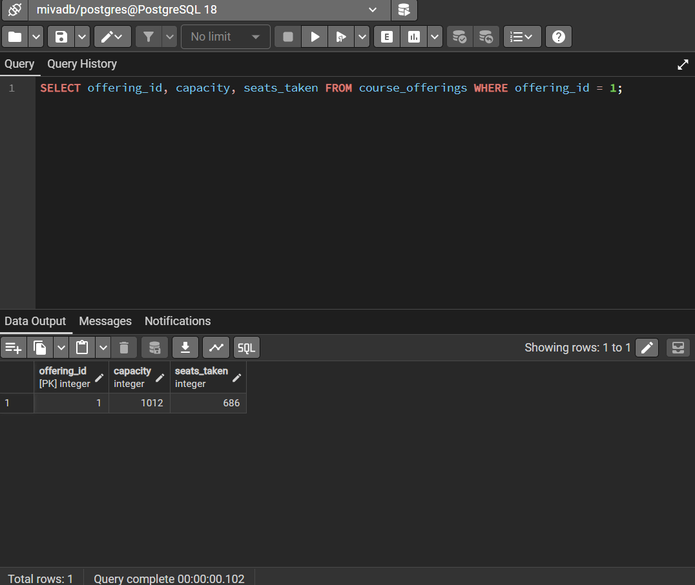
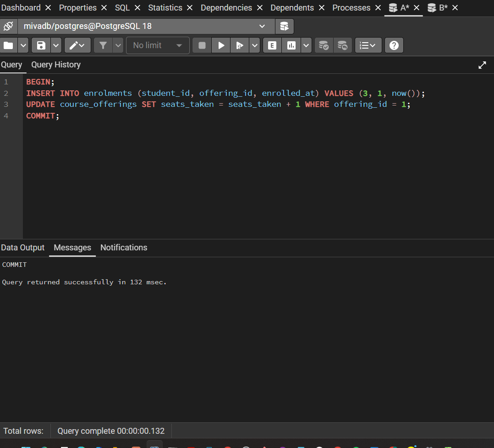
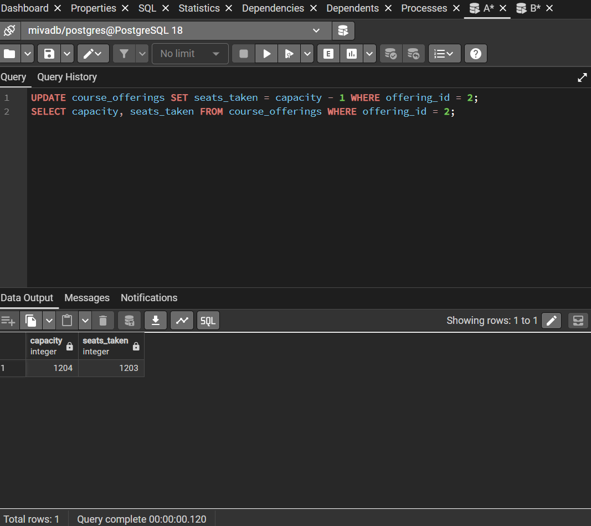
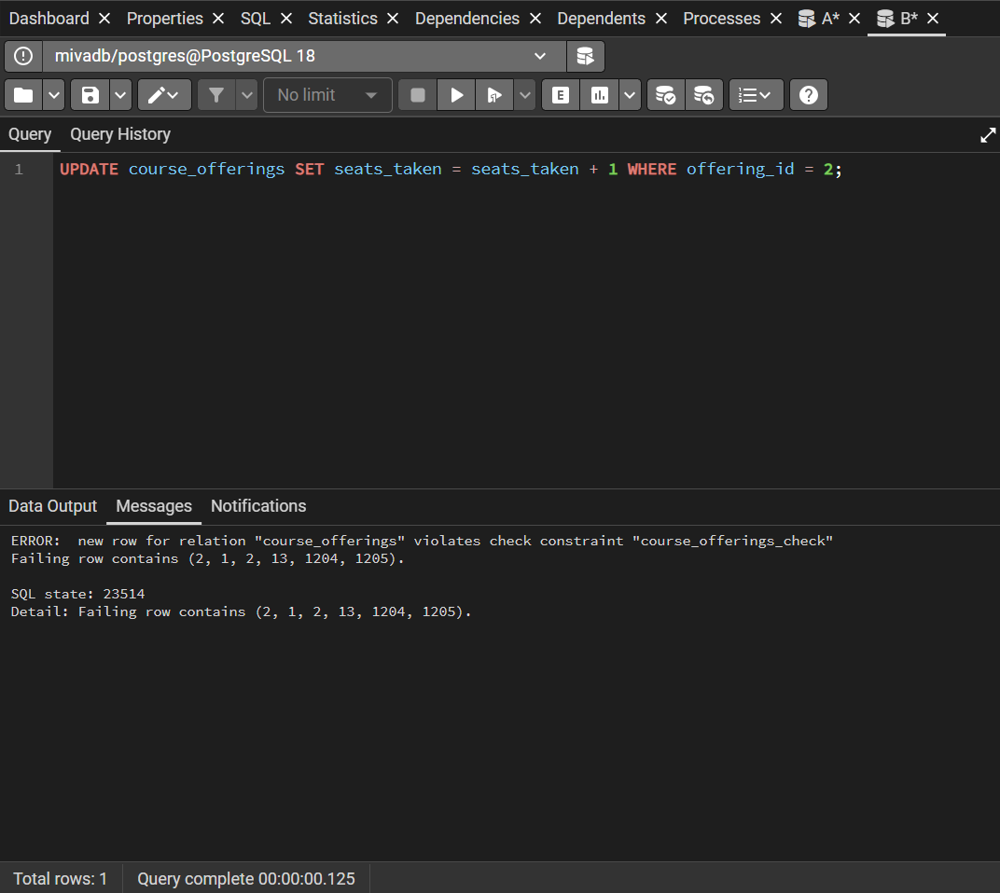

# Portfolio 3: Transactions and Concurrency

Database: MivaDB (PostgreSQL 18, pgAdmin 4). All SQL is in `transactions.sql`.
Two Query Tool tabs (A and B) were used as two separate sessions.

## 1. Atomicity: commit

Enrolling a student takes two steps: insert a row into `enrolments`, then add 1 to `seats_taken` on `course_offerings`. I wrapped both in one transaction for student 3 and offering 1.

```sql
BEGIN;
INSERT INTO enrolments (student_id, offering_id, enrolled_at) VALUES (3, 1, now());
UPDATE course_offerings SET seats_taken = seats_taken + 1 WHERE offering_id = 1;
COMMIT;
```

- Before: offering 1 had capacity 1012 and 686 seats taken.
- After COMMIT: 687 seats taken, and the enrolment row exists (enrolment_id 250003).
- Both sessions see the committed result.

The enrolment_id jumps from 250001 to 250003 because the sequence does not roll back. The rolled-back insert in my earlier test used up 250002.





## 2. Atomicity: rollback

Same two steps for student 4. Inside the open transaction `seats_taken` showed 688. I then ran ROLLBACK.

- After ROLLBACK: `seats_taken` was back to 687.
- No enrolment row existed for student 4.

Either both steps happen or neither does.


### Side observation
Session B ran the same block while A's transaction was still open. B hung, then finished only after A rolled back (the query took about 1 minute 20 seconds). This shows that an open transaction holds a lock on the row. Row locks are the same mechanism that fixes the race below.


## 3. Concurrency: the last-seat race

Offering 2 was set to one seat left (capacity 1204, seats_taken 1203).



### Without locking
Both sessions began a transaction and ran a plain SELECT, and both saw one free seat. A updated and committed first. When B then ran its update, PostgreSQL rejected it:

`new row for relation "course_offerings" violates check constraint "course_offerings_check"`
`Failing row contains (2, 1, 2, 13, 1204, 1205)`

Both sessions decided from the same stale read. Only the CHECK constraint stopped overbooking (1205 of 1204). B received a raw database error instead of a clean "offering full" result.



### With SELECT ... FOR UPDATE
The offering was reset to one seat left. A selected the row with `FOR UPDATE`, which locks it. When B ran the same statement it had to wait (the first screenshot shows it after about 4 seconds). After A updated and committed, B's query finished by itself after about 65 seconds and read the true count: 1204 of 1204. B saw the offering was full and rolled back without touching the data.


### Why it works
A plain SELECT does not stop other sessions from changing the row, so decisions can be based on out-of-date data. FOR UPDATE locks the row, so other sessions queue up and then read current data.

### Trade-off
Locking makes concurrent users wait. Transactions that hold locks should be kept short.

## ACID summary
- **Atomicity:** commit and rollback demos (sections 1 and 2).
- **Consistency:** the CHECK constraint refuses `seats_taken` above `capacity`.
- **Isolation:** the race shows what goes wrong without locking, and FOR UPDATE fixes it.
- **Durability:** the committed enrolment (250003) remained visible after COMMIT.
