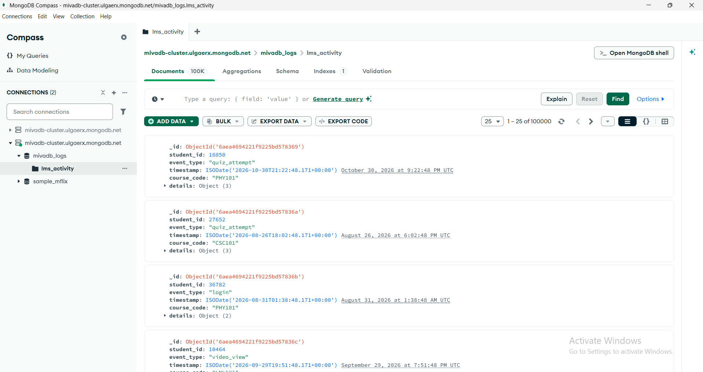

# Portfolio 4: NoSQL Database (MongoDB)

**Course:** MIT 8103 Advanced Database Systems
**Case study:** MivaDB, a student management and results system modelled on Miva Open University

## 1. Purpose

Portfolios 1 to 3 used PostgreSQL for the structured, relational side of MivaDB: students, courses, enrolments and results. This portfolio adds a second kind of data that a university learning platform produces constantly: **LMS activity logs**. These are events such as logins, video views, quiz attempts, forum posts and assignment submissions. I stored them in MongoDB Atlas to show where a document database fits better than a relational one.

## 2. Why MongoDB for activity logs

- **Flexible shape.** Each event type carries different fields. A login records a device, a quiz attempt records a score, a video view records minutes watched. In PostgreSQL this means many nullable columns or one table per event type. In MongoDB each event is one document with its own `details` object.
- **High volume, write-heavy.** Activity logs grow far faster than student or course records, and they are mostly inserted and read, rarely updated. This suits a document store that can scale out later.
- **No complex joins needed.** Most log queries filter or group events directly (one student's history, counts per event type), so the relational strengths of PostgreSQL are not needed here.

The structured academic records (students, courses, results) stay in PostgreSQL, where constraints, foreign keys and transactions matter. The two systems are linked by `student_id`.

## 3. Data model

Database: `mivadb_logs`. Collection: `lms_activity`. Each document looks like this:

```json
{
  "student_id": 16050,
  "event_type": "quiz_attempt",
  "timestamp": "2026-10-30T21:22:48Z",
  "course_code": "PHY101",
  "details": { "quiz_id": "QZ07", "score": 8, "out_of": 10 }
}
```

The `details` object changes with the event type:

| event_type | details fields |
|---|---|
| login | device, session_minutes |
| video_view | video_id, minutes_watched |
| quiz_attempt | quiz_id, score, out_of |
| forum_post | thread_id, message |
| assignment_submit | assignment_id, late |

## 4. How it was built

- `seed_mongo.py` inserts 100,000 synthetic events across 50,000 student IDs, 10 courses and 5 event types, in batches of 5,000.
- `queries_mongo.py` runs five queries and compares the student lookup before and after adding an index.
- The Atlas connection string is read from the `MONGO_URI` environment variable, so no password is stored in the repository.

To reproduce:

```
py -m pip install pymongo
$env:MONGO_URI = "mongodb+srv://<user>:<password>@<cluster>.mongodb.net/"
py seed_mongo.py
py queries_mongo.py
```

## 5. Queries

| # | Query | Type |
|---|---|---|
| Q1 | All activity for one student, newest first | Filter and sort |
| Q2 | Number of events per event type | Aggregation ($group) |
| Q3 | Average quiz score per course | Aggregation ($match, $group) |
| Q4 | Top 5 most active students | Aggregation ($group, $limit) |
| Q5 | Late assignment submissions per course | Aggregation ($match, $group) |

## 6. Results

### Index effect on Q1

An index on `(student_id, timestamp)` was created after the first measurement.

| | Before index | After index |
|---|---|---|
| Plan | COLLSCAN (full collection scan) | IXSCAN (index scan) |
| Documents examined | 100,000 | 4 |
| Documents returned | 4 | 4 |
| Execution time | 89 ms | 1 ms |

Without an index, MongoDB read every document to find 4 events. With the index it examined only those 4. The compound index also stores events in timestamp order for each student, so the "newest first" sort needs no extra work.

### Aggregation queries (Q2 to Q5)

| Query | Time |
|---|---|
| Q2 Events per type | 271 ms |
| Q3 Average quiz score per course | 298 ms |
| Q4 Top 5 most active students | 432 ms |
| Q5 Late submissions per course | 254 ms |

These queries have to read most or all of the collection to count and average, so the student index does not help them. This is the trade-off with indexes: they speed up targeted lookups but not full-collection analysis. At larger scale, options would include summary collections or pre-computed aggregates, similar to the materialized view used in Portfolio 2.

**Note on the data:** the events are randomly generated, so the averages (all near 5.0) and the "most active students" carry no real meaning. They demonstrate that the query patterns work, not findings about real student behaviour. Timings are single runs over the internet to a free Atlas cluster, so they will vary between runs.

## 7. Screenshots

Documents in `lms_activity` (Compass):



Query output, part 1:


Query output, part 2 (index created, Q1 after index):


## 8. PostgreSQL vs MongoDB: reflection

| | PostgreSQL (Portfolios 1 to 3) | MongoDB (this portfolio) |
|---|---|---|
| Best for | Structured, related records that must stay consistent | Varied, high-volume event data |
| Schema | Fixed, enforced | Flexible per document |
| Relationships | Foreign keys and joins | Referenced by ID only, not enforced |
| Transactions | Strong, as shown in Portfolio 3 | Possible, but not the main strength here |

The link between the two systems is `student_id`. MongoDB does not enforce that a student exists in PostgreSQL, so a real deployment would need the application layer to keep the two consistent. Using each database for what it does best gives a hybrid design: PostgreSQL as the system of record, MongoDB for activity logs.

## 9. Files

- `seed_mongo.py`: creates and fills the collection
- `queries_mongo.py`: runs the queries and the index comparison
- `screenshots/`: Compass and terminal evidence
