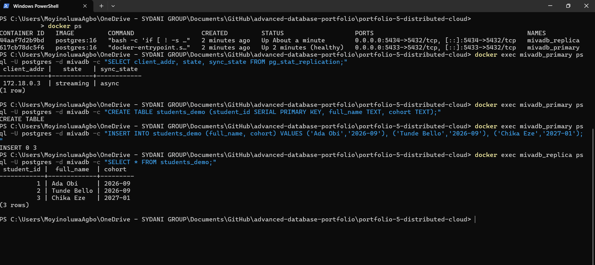
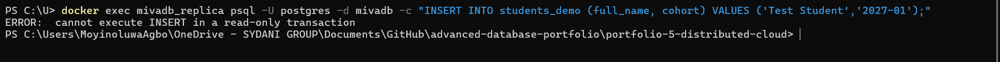

# Portfolio 5: Distributed and Cloud Database

**Course:** MIT 8103 Advanced Database Systems
**Case study:** MivaDB, a student management and results system modelled on Miva Open University

## 1. Purpose

A single database server is a single point of failure and a single limit on how many students can read results at the same time. This portfolio shows how MivaDB can be made more available and scalable by running PostgreSQL as a **primary** (accepts writes) with a **replica** (a live read-only copy), and discusses **sharding** as the next step if one primary is no longer enough.

## 2. What was built

Two PostgreSQL 16 containers started with Docker Compose:

| Container | Role | Local port |
|---|---|---|
| `mivadb_primary` | Accepts reads and writes | 5433 |
| `mivadb_replica` | Read-only copy, kept up to date automatically | 5434 |

Files in this folder:

- `docker-compose.yml`: defines both containers. The replica takes a base copy of the primary with `pg_basebackup`, then keeps streaming changes from it.
- `pg_hba.conf`: access rules, including permission for the replication user to connect.
- `init-primary.sql`: creates the `replicator` account on first start.

The passwords in these files are for a local demo only and would never be used in a real deployment.

To run it:

```
docker compose up -d
```

To stop it and delete all demo data:

```
docker compose down -v
```

## 3. Evidence that replication works

### 3.1 The replica is connected and streaming

Querying `pg_stat_replication` on the primary showed one connected client with state `streaming` and sync mode `async`.

### 3.2 A write on the primary appears on the replica

I created a `students_demo` table on the primary and inserted three students. I then queried the replica, where I had written nothing, and all three rows were there.



### 3.3 The replica refuses writes

Inserting a row directly on the replica fails with `cannot execute INSERT in a read-only transaction`. This protects the replica so the two copies cannot drift apart.



## 4. What replication gives MivaDB, and what it does not

**Benefits**

- **Read scaling.** Result checks and student dashboards could be read from the replica, leaving the primary free for enrolments and result entry.
- **Availability.** If the primary fails, the replica holds a recent copy and can be promoted to become the new primary.
- **Safe reporting.** Heavy report queries can run on the replica without slowing down live transactions.

**Limits**

- **Asynchronous replication.** The sync mode shown was `async`, so the primary confirms a write before the replica has received it. A student could briefly see old data on the replica, and a sudden primary crash could lose the most recent writes. Synchronous replication avoids this but makes every write wait for the replica.
- **Writes do not scale.** Every write still goes to one primary, so replication helps reads, not write capacity.
- **Failover is manual here.** In this demo nobody promotes the replica automatically. Real deployments use tools such as Patroni, or a managed cloud service that does it for them.
- **Replication lag was not measured** in this demo.

## 5. Sharding discussion: splitting students by cohort

**Idea.** Sharding splits one large dataset across several servers, each holding a part. For MivaDB the natural split is by **cohort** (intake), for example one shard for 2026-09 students, another for 2027-01, and so on. Each student's enrolments and results live on the same shard as the student.

**Advantages**

- Queries for one cohort touch one server, so they stay fast.
- Storage and write load are spread across servers.
- Old cohorts can sit on cheaper servers because they are rarely written to.

**Problems**

- **Uneven load.** The newest cohort gets almost all the activity (registration, results, quizzes), so that shard becomes a hot spot while old shards sit idle. Hashing `student_id` spreads load more evenly but loses the "one cohort, one server" simplicity.
- **Cross-shard queries.** Reports across all cohorts, such as the average score for a course over several intakes, must query every shard and combine the results.
- **Referential integrity.** Foreign keys cannot be enforced across servers, so the application has to protect those links.
- **Complexity.** Rebalancing, backups and schema changes become harder with every extra shard.

**Recommendation for MivaDB.** At the scale tested in this project (50,000 students and about 250,000 enrolments), one PostgreSQL primary with a replica, good indexes (Portfolio 2) and table partitioning is enough. Partitioning by cohort inside a single server gives much of the benefit of cohort sharding without the distributed complexity. Sharding across servers should only be considered when a single primary can no longer handle the write load or storage, at which point an extension such as Citus or a managed distributed database would be the next step.

## 6. Cloud link

In Portfolio 4 the MongoDB Atlas cluster is already a managed, cloud-hosted replica set, so replication, failover and backups are handled by the provider. The Docker setup in this portfolio shows how the same idea works when you run it yourself, which is what a managed service hides.

## 7. Reflection

Replication is easy to set up and gives a real availability and read-scaling gain. Sharding is a much bigger commitment and is only justified by genuine scale. Starting simple (indexes, one primary, a replica, partitioning) and adding complexity only when measurements demand it is the more sensible path for a system like MivaDB.
